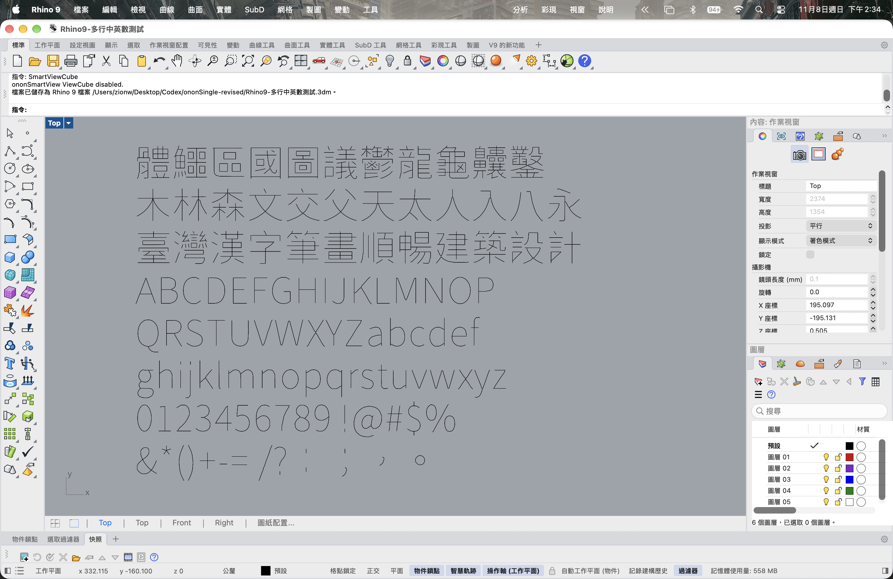

# ononSingle

以 Google Fonts Noto Sans TC 衍生的 Rhino 單線字型，包含繁體中文、英文字母、數字及符號。

## 使用方法

安裝 `ononSingle.ttf` 並重新啟動 Rhino。使用 **TextObject（文字方塊）**，選擇 ononSingle、輸出「曲線」並勾選「雕刻字體」。一般使用不需要 Python；輸出是曲線，不能以可編輯文字工具修改。

## 本版測試及限制

這次修正了「木」字筆畫，以及 374 個字形中 490 處與 Google 原字形比對後疑似缺角的方框。截圖為 Rhino 9 的方框修正試版，包含中英文、數字與符號；測試文件共 707 條有效曲線。字型名稱於測試後改回 ononSingle，字形內容相同。

這是試用版：尚未逐字檢視全部方框，也尚未全面修順撇、捺交會處或逐字核對筆順。Mac Rhino 的部分曲線方向可能反轉；加工軟體也可能重新排列刀路。

## 授權

原始字型來自 [Google Fonts Noto Sans TC](https://github.com/google/fonts/tree/main/ofl/notosanstc)。本字型為衍生作品，非 Google 官方產品；依 SIL Open Font License 1.1 發布，版權及授權聲明見 [OFL.txt](OFL.txt)。
